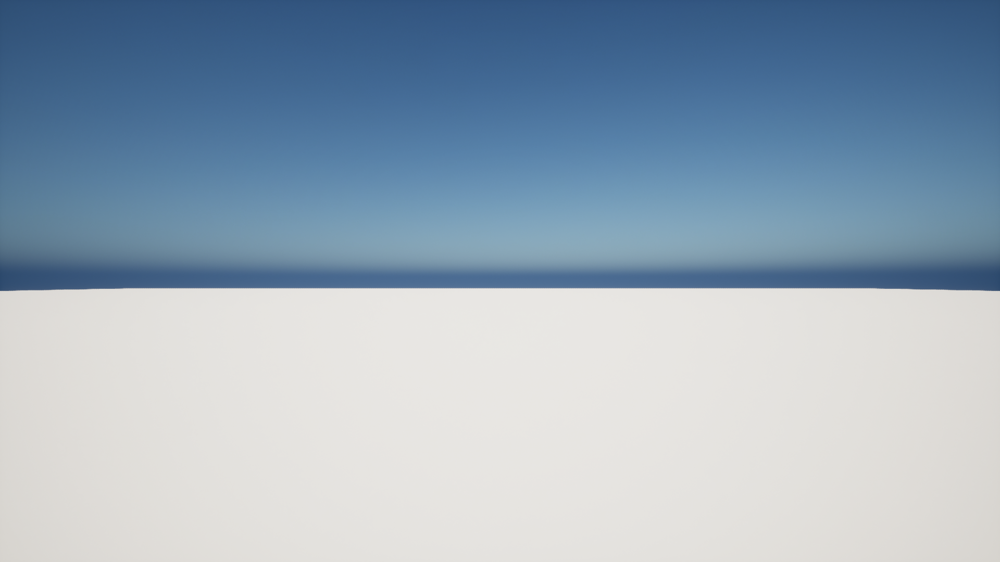

# Development Updates

## 2026-11-25 — Player character and dual camera (Milestone 2)

The player can now walk, run, sprint, crouch and jump, and switch between first-person and third-person at any moment.

- **One character, two views.** Switching only changes the camera. Your speed, direction, aim, crouch and jump carry straight through, even mid-air.
- **Smooth switch:** a quarter-second blend, no loading. If a switch can't happen right then (in future, during a cutscene or a climb), it waits and happens as soon as it can, instead of being ignored.
- **First person** uses Unreal Engine 5.8's first-person rendering, so arms and weapons won't clip into walls.
- **Third person** has an over-the-shoulder camera that stays out of walls and ceilings.
- **Controls:** V on keyboard or D-pad Up on controller to switch views, and the bindings can be changed.
- **Ultrawide:** 21:9 screens see more of the world, not less.
- Head bob can be turned down to zero for players sensitive to camera motion.

*Third person in the camera test area. The character is Epic's standard mannequin, a temporary placeholder.*

*The same spot in first person.*

*21:9 ultrawide: same vertical framing, wider view.*

**Next:** core gameplay, covering interaction, health and stamina, a first melee and ranged/magic weapon, and a first enemy, all playable in both views.

## 2026-11-25 — Foundation complete (Milestone 1)

The technical foundation is in place:

- The project now runs on its own C++ code (Unreal Engine 5.8).
- **Save system:** versioned saves that also protect against crashes. Every save is checksummed, and if the latest save is damaged, the game falls back to the previous one automatically.
- **Settings:** groundwork for camera and accessibility options, including separate first- and third-person field of view, look sensitivity and inversion, and camera shake and head-bob reduction.
- An automated test suite that checks these systems on every build.
- Modern lighting is switched on (Lumen global illumination and virtual shadow maps).

*First engine test map. Placeholder floor and sky only; used to verify the lighting setup.*

**Next:** the player character and the first-person/third-person camera system. You will be able to switch between the two at any time.

## 2026-11-25 — Project kick-off

- Completed the full design specification and a technical audit of the starting project.
- Locked the engine version: Unreal Engine 5.8.
- Set up source control and the development toolchain.
